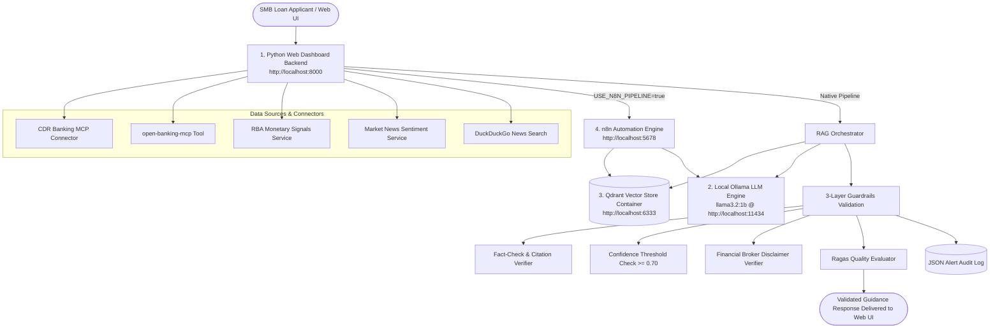

# rag-pipeline

# RAG Pipeline Project: "Smart-Business Loan Rate Advisor" 📈

A production-grade local RAG pipeline built for Australian SMB owners navigating interest rate decisions (fixing vs variable rates). The system combines Consumer Data Right (CDR) banking profiles (`CUST_001`), Open Banking product recommendations (`open-banking-mcp`), Reserve Bank of Australia (RBA) cash rate signals, and financial market sentiment with strict 3-layer guardrail validations to eliminate hallucinations.

---

## Watch Live Demo on YouTube

|Demo|Walkthrough|
|:-:|:-:|
|[](https://www.youtube.com/watch?v=mS4pmnHNEBI)|[](https://www.youtube.com/watch?v=mS4pmnHNEBI)|


*Click the preview image above to watch the full live demo walkthrough of this RAG Pipeline: Smart-Business Loan Rate Advisor on YouTube.*

## Big Picture Architecture

The application relies strictly on a clean **4-Component Local Architecture**:


---

## 📖 Comprehensive Guides

- **[CLI Demo & Recording Script](docs/RUN_CLI.md)**: Full step-by-step terminal execution commands, `curl` queries, and exact sample JSON outputs for recording demos.
- **[Web UI & Inspection Guide](docs/RUN_UI.md)**: Interactive web dashboard guide, status indicator checks, and log audit inspection.
- **[n8n Workflow Setup Guide](docs/n8n_setup_guide.md)**: End-to-end instructions for importing and running n8n RAG workflows with Qdrant.
- **[Architecture & Concepts Q&A Walkthrough](Q_and_A_style_walkthrough.md)**: 34 foundational, big-picture, and technical Q&A pairs explaining vectors, embeddings, Qdrant, tokenization, and pipeline flow.

---

## 🚀 Quick Start Guide

### 0. Configure Environment Variables
Copy `.env.example` to `.env` for local testing and development:
```bash
cp .env.example .env
```

### 1. Launch Infrastructure Containers (Docker Compose)
```bash
# Recommended: One command to launch n8n & Qdrant infrastructure
docker compose up -d

# Alternatively using individual docker run commands:
# docker run -d --name qdrant_vector_store -p 6333:6333 -p 6334:6334 -v qdrant_storage:/qdrant/storage qdrant/qdrant:latest
# docker run -d --name n8n_automation -p 5678:5678 -v n8n_data:/home/node/.n8n n8nio/n8n:latest
```

### 2. Launch Local Ollama LLM & Embedding Models
```bash
# Serve Ollama and pull required models
OLLAMA_HOST=0.0.0.0:11434 ollama serve

# LLM Text Generation Model
ollama pull llama3.2:1b

# Dedicated Vector Embedding Model (for Qdrant & n8n RAG)
ollama pull nomic-embed-text
```

### 3. Start Python Web Backend
```bash
source venv/bin/activate && python dashboard/server.py
```
Open [http://localhost:8000](http://localhost:8000) in your browser.

* For a step-by-step visual run, see the [Web UI Verification Guide](docs/RUN_UI.md).
* For terminal-based query testing, see the [CLI Verification Guide](docs/RUN_CLI.md).
* Having issues with connection or model setup? Check the [Troubleshooting & Setup Fixes Guide](docs/TROUBLESHOOTING.md).

| Component | Port & Endpoint | Description | Command / Execution |
|---|---|---|---|
| **1. Python Web Dashboard Backend** | [http://localhost:8000](http://localhost:8000) | Flask API & Glassmorphic Dashboard UI | `source venv/bin/activate && python dashboard/server.py` |
| **2. Local Ollama LLM Engine** | [http://localhost:11434](http://localhost:11434) | Local LLM (`llama3.2:1b`) | `OLLAMA_HOST=0.0.0.0:11434 ollama serve && ollama run llama3.2:1b` |
| **3. Qdrant Vector Database Container** | [http://localhost:6333](http://localhost:6333) | Vector store & visual dashboard (`:6333/dashboard`) | `docker run -d --name qdrant_vector_store -p 6333:6333 -p 6334:6334 -v qdrant_storage:/qdrant/storage qdrant/qdrant:latest` |
| **4. n8n Automation Engine (Docker)** | [http://localhost:5678](http://localhost:5678) | Ingestion & retrieval workflow engine | `docker run -d --name n8n_automation -p 5678:5678 -v n8n_data:/home/node/.n8n n8nio/n8n:latest` |

---

## 📁 User Guides

```
├── README.md                           <-- Main Project Overview & Architecture Guide
├── docs/
│   ├── RUN_CLI.md                      <-- Dedicated CLI Demo & Recording Script
│   ├── RUN_UI.md                       <-- Dedicated Web UI & Inspection Guide
│   ├── n8n_setup_guide.md              <-- n8n Integration Guide
│   └── TROUBLESHOOTING.md              <-- Connection & Setup Troubleshoot Guide
├── n8n_workflows/
│   ├── 1_data_ingestion_workflow.json  <-- n8n Vector Ingestion Workflow
│   ├── 2_retrieval_rag_chain_workflow.json <-- n8n Primary RAG Retrieval Chain
│   └── 2_retrieval_rag_chain_workflow_2.json <-- n8n Secondary RAG Retrieval Chain
├── data/
│   ├── mock_cdr_loans.json             <-- CDR Open Banking Customer Profiles
│   ├── mock_rba_signals.json           <-- RBA Monetary Cash Rate Data
│   └── mock_market_sentiment.json      <-- Financial Market Sentiment Index
├── logs/
│   ├── guardrails_alerts.json          <-- Guardrail Decision & Safety Log
│   └── pipeline_execution.log          <-- Pipeline Execution System Log
└── architecture/
    └── ARCHITECTURE.md                 <-- System Design & Architectural Diagram
```

---

## 🔒 Disclaimer
This software is provided for educational and decision support purposes only. It does not constitute personal financial product advice. Always consult a licensed mortgage broker or financial advisor before committing to loan rate modifications.
