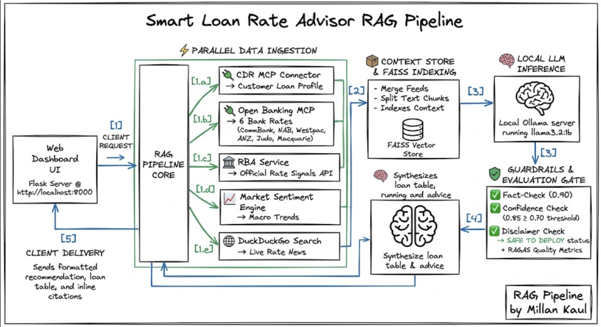
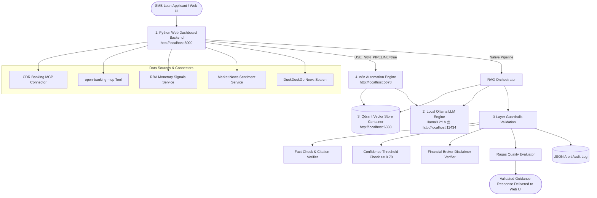

# Smart Loan Rate Advisor - System Architecture

## Overview
The Smart Loan Rate Advisor is a production-ready local RAG system designed for Australian Small and Medium-sized Businesses (SMBs) considering interest rate lock-ins. The architecture cleanly separates into **4 core components**:

### 4-Component Architecture

1. **Python Web Dashboard Backend (`dashboard/server.py`)**
   - Running at: `http://localhost:8000`
   - Serves the glassmorphic HTML/CSS/JS interface, exposes API endpoints (`/api/market_data`, `/api/mcp/business-loans`, `/api/query`, `/api/health`), and coordinates Python-native RAG execution or n8n webhook forwarding.

2. **Local Ollama LLM Engine (CLI)**
   - Running at: `http://localhost:11434`
   - Serves local LLM inference using `llama3.2:1b` (and text embeddings).

3. **Qdrant Vector Database Container (Docker)**
   - Visual Dashboard at: `http://localhost:6333/dashboard`
   - High-performance vector database storing document embeddings for similarity retrieval.

4. **n8n Automation Engine (Docker)**
   - Running at: `http://localhost:5678`
   - Orchestrates automated ingestion and RAG chain workflows (`n8n_workflows/`).

---

## Key Components

1. **Python Web Dashboard Backend (`dashboard/server.py`)**: Glassmorphic UI & Flask server.
2. **Local Ollama Engine**: Host LLM server running `llama3.2:1b`.
3. **Qdrant Vector Store**: Local vector collection (`loan_advisor_rag`).
4. **n8n Automation Workflows (`n8n_workflows/`)**: Ingestion and retrieval workflows.
5. **Guardrails & Evaluation Layer (`src/guardrails/`, `src/evaluator.py`)**: Strict fact checks, confidence thresholding (≥0.70), disclaimers, and Ragas metrics.

