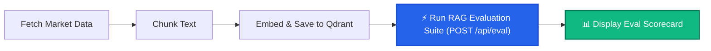

# Smart Loan Rate Advisor - Local n8n RAG Setup Guide

This guide details how to import, configure, and run the local **n8n** automation workflows for the RAG pipeline.

---

## 🚀 1. Import n8n Workflows

In case your n8n is not up, run `docker compose up` from the root or directly run this command to start n8n:
```bash
docker run -d --name n8n_automation -p 5678:5678 -v n8n_data:/home/node/.n8n n8nio/n8n:latest
```

Open your n8n UI at **`http://localhost:5678`**:

1. **Workflow 1 (Data Ingestion)**:
   - Click **Workflows** > **Import from file**.
   - Select `n8n_workflows/1_data_ingestion_workflow.json` (or `n8n_workflows/1.1_data_ingestion_workflow_with_evals.json` with evaluation hook).
   - This workflow fetches CDR bank data, embeds it with `nomic-embed-text`, and indexes it into Qdrant.

2. **Workflow 2 (RAG Chain & Chat Webhook)**:
   - Click **Workflows** > **Import from file**.
   - Select `n8n_workflows/2_retrieval_rag_chain_workflow_2.json` (or `n8n_workflows/2.2_retrieval_rag_chain_workflow_with_evals.json` with post-chat automated evaluation suite).
   - Once imported, click **Publish** (or toggle the top-right switch to **Active**).

---

## 🧸 Explain Like I'm 5: How The Workflows & Evals Work

Imagine you are running a **School Library**:

### 1. Ingestion (Workflow 1) = The Librarian Stocking the Books
- The librarian gets new books from banks and government reports.
- She snips them into small bite-sized note cards (chunks).
- She slaps special barcodes on them so they can be matched to questions later (**embeddings** via `nomic-embed-text`).
- She neatly places them onto the library shelves (**Qdrant vector database**).

### 2. Retrieval & RAG (Workflow 2) = A Student Asking for Help
- A student walks in and asks: *"Should I lock in my interest rate at 5.2%?"*
- The smart assistant rushes to the bookshelf, grabs the 3 most relevant cards, reads them, and writes a smart answer using its AI brain (`llama3.2:1b`).

### 3. What on Earth are "Evals" (Evaluations)?
- Evals are like the **Teacher with a Red Pen** 👩‍🏫 grading the test!
- The teacher asks three simple questions:
  1. **Faithfulness**: *Did the AI tell the truth based on the library books, or did it make up a wild story?*
  2. **Answer Relevance**: *Did the AI actually answer the question asked, or did it babble about unrelated things?*
  3. **Context Relevance**: *Did the librarian pull the right cards from the shelf, or grab useless junk?*

---

### 🔌 What Workflow 1.1 Does (Ingestion + Live Eval Suite)

When the librarian finishes putting books on the shelf, she immediately does a **live pop quiz**:
> *"Hey! I just put all these new loan rates on the shelf. Let me ask 3 golden test questions right now through our AI brain to verify retrieval quality, answer faithfulness, and guardrail compliance!"*

That is what **Workflow 1.1** (`1.1_data_ingestion_workflow_with_evals.json`) does!



1. **Vector Ingestion**: Chunks and indexes the latest rates into Qdrant collection `loan_advisor_rag`.
2. **Automated Eval Trigger**: Calls `POST http://host.docker.internal:8000/api/eval` with the golden test questions.
3. **Live Ragas Scoring**: Evaluates retrieved chunks and answers against ground truth:
   - **Context Relevance**: Measures whether retrieved chunks match the query.
   - **Faithfulness**: Measures whether answers are strictly grounded in context without hallucinations.
   - **Answer Relevance**: Measures whether answers directly solve the user's intent.
4. **Display Eval Scorecard**: Returns a formatted report directly inside n8n with overall grade (e.g. `83%`), pass rate (`100%`), and individual test breakdowns.

---

## 🔍 Where to See the Actual Run Results

When you run Workflow 1.1, the evaluation results appear across 3 locations:

1. **Inside n8n (Live Scorecard)**:
   - Click the **`Display Eval Scorecard`** node (or **`Run RAG Evaluation Suite`**).
   - In the right-hand panel, view the **OUTPUT** tab (toggle Table or JSON) to inspect:
     - `🎯 EVALUATION RESULT`: `PASSED`
     - `📊 OVERALL RAGAS SCORE`: `83%`
     - `✅ PASS RATE`: `100%`
     - `📈 RAGAS QUALITY METRICS`: Context Relevance, Faithfulness, Answer Relevance
     - `📋 QUERY BREAKDOWN`: Each golden query with individual score and snippet.
   - Click **Executions** in the left sidebar (`http://localhost:5678/executions`) to see run history.
2. **Inside the Dashboard API & Audit Trail**:
   - The evaluation automatically logs to `logs/guardrails_alerts.json`.
   - You can also query the evaluation endpoint directly:
     ```bash
     curl -s http://localhost:8000/api/eval | jq .
     ```
3. **Inside Qdrant Vector Dashboard**:
   - Open **[http://localhost:6333/dashboard](http://localhost:6333/dashboard)** in your browser.
   - Click on the collection **`loan_advisor_rag`** to view point counts and raw stored vector payloads.

---

## ⚙️ 2. Workflow & Node Configuration

### How to Connect n8n to Ollama (Choose Your Setup Mode)

Depending on how you choose to run Ollama, select the corresponding URL when configuring Ollama credentials in n8n:

| Setup Mode | How Ollama is Running | URL to Enter in n8n Credentials | Notes |
| :--- | :--- | :--- | :--- |
| **Mode 1: Docker (Container)** | `docker run -d --name ollama ...` on the same Docker network | **`http://ollama:11434`** | Use when both n8n and Ollama are containers on the same Docker network (`rag-pipeline_default`). |
| **Mode 2: Local Host (Native)** | Running on host (`ollama serve` via Terminal/App) | **`http://host.docker.internal:11434`** | Use when Ollama runs directly on your Mac/Windows host (leverages Apple Silicon Metal GPU). |
| **Universal Fallback** | Ollama with port `11434:11434` mapped to host | **`http://host.docker.internal:11434`** | Works in **both** scenarios since port 11434 forwards through the host gateway. |

---

### Workflow 1: Data Ingestion & Indexing (Step-by-Step Setup)

When importing this workflow, n8n strips credential links for security. Follow these steps to attach them and avoid the `"Node does not have any credentials set"` error:

1. **Configure Qdrant Vector Store Credential**:
   - Double-click on the **Qdrant Vector Store** node (green node on the right).
   - Under **Credential to connect with**, click the dropdown and select **`- Create new credential -`** (or select your existing `Qdrant Api` credential).
   - Set **Qdrant Server URL**: `http://host.docker.internal:6333`
   - Set **API Key**: *Leave completely empty / blank* (local Qdrant does not require an API key).
   - Click **Save**.
2. **Configure Embeddings Ollama**:
   - Double-click on the **Embeddings Ollama** node.
   - **Model**: `nomic-embed-text`
   - **Base URL / Credential**: `http://host.docker.internal:11434`
   - Click **Save**.
3. **Execute Ingestion**:
   - Click **Save** in the top right of the workflow editor.
   - Click **Test workflow**. n8n will fetch CDR data, chunk documents, embed them with `nomic-embed-text`, and insert vectors into Qdrant.
   - Verify that vectors are populated by opening the Qdrant Dashboard at **[http://localhost:6333/dashboard](http://localhost:6333/dashboard)** (you will see the point count increase from `0` to ~`15–20` points).

---

### Workflow 2: Retrieval & RAG Chain (Step-by-Step Setup)

1. In n8n, click **Workflows** > **Import from file** and select `n8n_workflows/2_retrieval_rag_chain_workflow.json`.
2. Double-click on the **Ollama LLM (llama3.2:1b)** node and verify its URL is set to `http://host.docker.internal:11434/api/generate` with model `llama3.2:1b`.
3. Click **Save** in the top right.
4. Toggle the top-right workflow switch from **Inactive** to **Active**.
5. Once Active, queries from the Web Dashboard or direct webhooks to `http://localhost:5678/webhook/loan-advisor-query` will trigger this workflow.

---

## 🧪 3. Testing n8n Execution

### 1. Ingestion Run
- Click **Test Workflow** inside the Data Ingestion workflow to trigger index creation and vector population in Qdrant.
- Verify that vectors are populated by opening the Qdrant Dashboard in your browser at: **`http://localhost:6333/dashboard`**

### 2. Querying the Webhook
You can query the RAG retrieval chain directly via `curl`:
```bash
curl -X POST http://localhost:5678/webhook/loan-advisor-query \
  -H "Content-Type: application/json" \
  -d '{"query": "Should I lock in at 5.2% given current market conditions?", "customer_id": "CUST_001"}'
```
